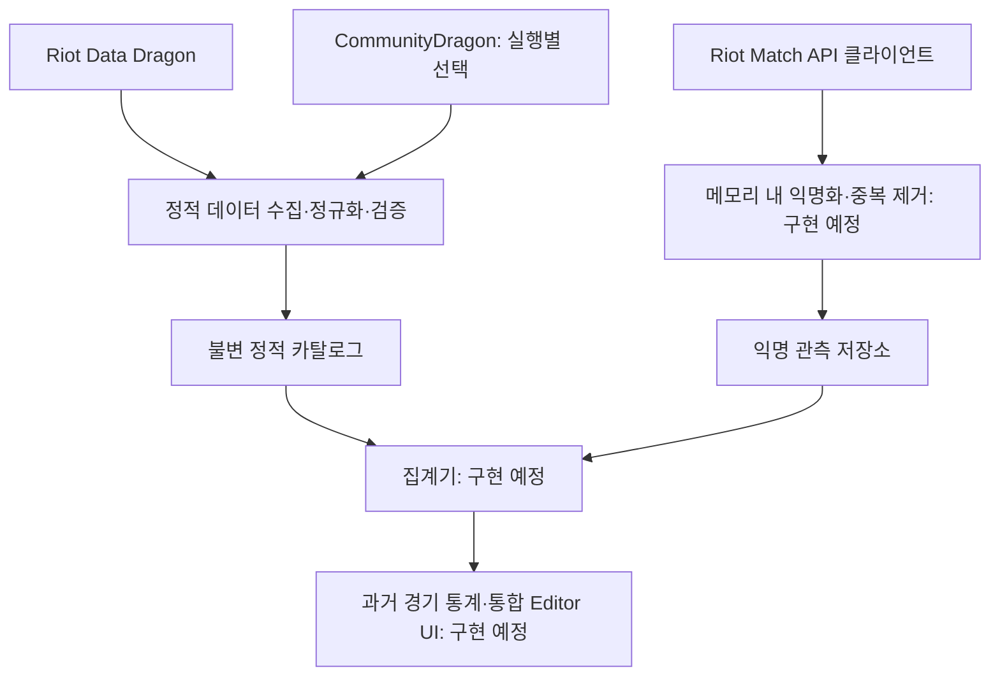

# TFTDataAnalyzer

Unity Editor에서 **Teamfight Tactics(TFT)의 시즌·패치별 정적 데이터를 관리하고, 과거 경기 결과의 익명 집계 통계를 분석하기 위한 도구**입니다.

첫 지원 대상은 Set 18이며, 이후 다른 시즌도 동일한 데이터 팩 구조로 추가할 수 있도록 설계했습니다. 이 저장소의 로컬 폴더 이름은 `TFTSimulator`이지만, 제품의 범위는 데이터 분석입니다. 전투 시뮬레이션이나 미래 승패 예측은 포함하지 않습니다.

## 개발 현황

| 단계 | 주요 내용 | 현재 상태 |
|---|---|---|
| 1. 정적 데이터 파이프라인 | 공식 데이터 수집, 선택형 보완 소스, 정규화·검증·패치 비교, 불변 카탈로그 저장 | 구현됨 |
| 1-1. 카탈로그 식별자 강화 | 세트·패치·원본 버전·출처 프로필 분리, 기존 데이터 호환, 무결성 검증 | 구현됨 |
| 2. 익명 경기 통계 | Match API 수집, 메모리 내 익명화, 중복 제거, 집계와 신뢰구간 | 관측 모델·API 클라이언트 구현, 익명화·저장·집계 예정 |
| 3. 통합 Editor UI | 데이터 관리·경기 수집·분석·정책 안내 화면 | 설계 및 구현 계획 작성 |

현재는 정적 데이터 가져오기 창을 사용할 수 있습니다. 경기 API 클라이언트는 키 안전성·호출 제한·재시도를 포함하며, 익명화와 수집 화면 연결은 다음 작업입니다. 2026-10-16에 실제 Unity EditMode 전체 174개가 통과했습니다. 기존 카탈로그 로드·인덱스 저장·Import 창 기본화면도 확인한 상태입니다. 실제 네트워크 import·Match API 호출과 네이티브 확인창 클릭은 미실행입니다.

## 핵심 설계

### 데이터 출처와 병합

- **Riot Data Dragon**을 정적 데이터의 1차 출처로 사용합니다.
- **CommunityDragon**은 공식 데이터에 없는 필드를 보완할 때만 사용하며, 가져오기 실행마다 사용자가 명시적으로 선택합니다.
- 한국어와 영어 데이터를 안정 ID로 연결하고, 한국어가 없어 영어로 대체한 경우를 기록합니다.
- 공식 값이 있으면 우선하고, 충돌과 보완 내역은 출처와 함께 남깁니다.
- 과거 경기 결과는 공식 **Riot Match API**로 수집하도록 설계했습니다.

관리 대상은 기물, 시너지, 아이템, 증강과 패치 매니페스트입니다. 매니페스트에는 원본 URL, 수집 시각, ETag, SHA-256 등의 출처·무결성 정보를 기록합니다.

### 카탈로그 식별과 불변 저장

카탈로그는 패치 번호만으로 구분하지 않고 다음 네 필드를 함께 사용합니다.

```text
CatalogIdentity = (setId, patchId, sourceGameVersion, sourceProfile)
```

| 필드 | 의미 | 기준 데이터 예시 |
|---|---|---|
| `setId` | 시즌 식별자 | `TFTSet18` |
| `patchId` | TFT 패치 식별자 | `18.2` |
| `sourceGameVersion` | 원본 데이터의 게임 빌드 버전 | `16.18.1` |
| `sourceProfile` | 공식 전용 또는 보완 소스 포함 여부 | `official-only` |

출처 프로필은 `official-only`와 `official-plus-communitydragon` 두 가지입니다. 같은 패치라도 원본 버전이나 출처 프로필이 다르면 별도 카탈로그로 보관합니다.

- 동일 입력은 동일한 정규화 JSON과 콘텐츠 해시를 생성합니다.
- 같은 식별자의 기존 카탈로그를 다른 내용으로 덮어쓰지 않습니다.
- 검증 실패·취소·저장 오류가 발생하면 기존 카탈로그를 보존합니다.
- 패치 간 추가·변경·삭제 항목을 비교할 수 있도록 변경점 계산기를 제공합니다.
- 기존 schema 1 공식 전용 데이터는 출처와 해시를 확인한 뒤 기존 경로에서 읽으며, 파일을 이동하거나 수정하지 않습니다.

### 전체 데이터 흐름



## 경기 분석 설계 — 구현 예정

경기 종료 시점의 기물·성급·장착 아이템·활성 시너지·증강을 하나의 **관측 조합**으로 다룹니다. 이는 경기 전체에서 사용한 조합이나 라운드별 전투 기록을 의미하지 않습니다.

| 지표 | 정의 |
|---|---|
| 평균 최종 순위 | 같은 조건의 관측 조합이 기록한 최종 순위의 평균 |
| Top 4 비율 | 최종 순위가 1~4위인 관측의 비율 |
| 1위 비율 | 최종 순위가 1위인 관측의 비율 |
| 상대 배치 우위율 | 같은 로비에 두 조합이 함께 관측됐을 때 한 조합의 최종 순위가 더 높았던 비율 |

통계는 카탈로그 전체 식별자, 지역, 큐, 티어 구간별로 구분합니다. 결과에는 표본 수와 수집 기간을 표시하고, 비율 지표에는 **95% Wilson 신뢰구간**을 함께 제공합니다. 기본 최소 표본은 **100건**이며, 미달하면 비율 대신 `표본 부족`을 표시하도록 설계했습니다.

### 수집과 저장 원칙

- API 키는 `RIOT_API_KEY` 환경 변수 또는 OS 자격 증명 제공자에서만 읽습니다.
- 키를 프로젝트 파일, `EditorPrefs`, URL, 명령줄 인자나 로그에 저장하지 않습니다.
- 식별 정보가 포함된 원본 Match API 응답은 디스크나 로그에 기록하지 않습니다.
- 플레이어 이름과 PUUID는 메모리에서 제거하고, 원본 Match ID는 중복 제거용 SHA-256 해시로 변환합니다.
- 익명 관측과 집계 결과만 로컬 저장소에 보관합니다.
- 호출 제한과 `Retry-After`를 반영하고, 사용자가 수집량을 제한하거나 취소할 수 있도록 합니다.

## 제품 범위

패치별 데이터 탐색, 패치 비교, 과거 관측의 익명 집계가 대상입니다. 설계에서 다음 기능은 제외했습니다.

- 전투 규칙 재현, 가상 전투, 라운드별 전투 승률 및 미래 승패 예측
- 실시간 보드·상점·상대 정보 수집, Spectator API, 화면 인식, 클라이언트 메모리 접근, 인게임 오버레이
- 플레이 중 행동 추천, 플레이어 검색·프로필 및 식별 정보 표시
- Legends 및 Legend 기반 증강 승률 지표

전투 기술 연구가 필요하면 창작 데이터와 에셋을 사용하는 별도 프로젝트에서 진행한다는 것이 기존 설계의 경계입니다.

## 시작하기

1. 저장소를 복제한 뒤 Unity Hub에서 프로젝트 폴더를 추가합니다.
2. **Unity 6000.3.8f1**로 열고 패키지 복원과 스크립트 컴파일을 기다립니다.
3. 상단 메뉴에서 **`TFT Analyzer > Data > Import Set 18 Patch...`**를 엽니다.
4. 세트·패치·원본 게임 버전을 확인하고, 필요한 경우에만 CommunityDragon 보완을 선택합니다.
5. 확인 창의 카탈로그 식별자와 저장 경로를 검토한 뒤 가져오기를 실행합니다.

저장소에 포함된 공식 전용 기준 카탈로그는 `TFTSet18 / 18.2 / 16.18.1`입니다. 이는 포함된 데이터의 식별자이며 최신 패치를 뜻하지 않습니다. 정적 데이터 가져오기에는 Riot Match API 키가 필요하지 않습니다.

## 프로젝트 구조

| 경로 | 역할 |
|---|---|
| `Assets/TFTAnalyzer/Core/` | Unity 비의존 데이터 모델, 정규화 직렬화·해시, 검증, 패치 비교 |
| `Assets/TFTAnalyzer/Editor/` | 외부 데이터 어댑터, 수집 파이프라인, 저장·인덱스, 가져오기 창 |
| `Assets/TFTAnalyzer/Tests/` | EditMode 테스트와 축약 테스트 픽스처 |
| `Assets/TFTAnalyzer/Data/Generated/` | 정적 카탈로그, 매니페스트, 아이콘, 카탈로그 인덱스 |
| `Assets/Plan/` | 확정 설계, 단계별 구현 계획, 개발 인계 기록 |
| `Library/TftAnalyzerCache/` | 정적 원본·임시 다운로드 캐시. Git 제외 |
| `Library/TftAnalyzerStore/` | 향후 익명 관측·집계 저장소. Git 제외 |

신규 카탈로그의 저장 경로는 다음과 같습니다.

```text
Assets/TFTAnalyzer/Data/Generated/{setId}/{patchId}/{sourceGameVersion}/{sourceProfile}/
```

기존 schema 1 기준 데이터는 `Assets/TFTAnalyzer/Data/Generated/TFTSet18/18.2/`에 유지합니다.

## 기술 환경과 검증

- Unity `6000.3.8f1`, C#
- Unity Test Framework `1.6.0`, Newtonsoft Json `3.2.2`
- 네트워크: UnityWebRequest
- 통합 UI 계획: UI Toolkit / UXML / USS
- 선택형 자동화: Unity CLI / Pipeline `0.7.0-exp.1`

Unity의 **`Window > General > Test Runner`**에서 EditMode 테스트를 실행할 수 있습니다. 테스트 어셈블리는 `TFTAnalyzer.Tests.EditMode`입니다.

기본 테스트는 네트워크나 Riot API 키 없이 픽스처를 사용합니다. 외부 네트워크 검증은 `[Explicit]` 테스트로 분리합니다. 소스 매핑, 공식 값 우선 병합, 참조 검증, 결정적 직렬화, 불변 저장, 버전·출처 프로필 공존과 오류 복구를 검증하며, 경기 분석 단계에서는 익명화·중복 제거·집계·최소 표본 차단 검증을 추가할 계획입니다.

## 코드 리뷰

CodeRabbit의 저장소 설정은 [`.coderabbit.yaml`](.coderabbit.yaml)에서 관리합니다.

- 변경 작업은 별도 브랜치에서 진행하고 `main`을 대상으로 PR을 생성합니다.
- 일반 PR은 한국어로 자동 리뷰하며, Draft PR은 자동 리뷰 대상에서 제외합니다.
- 추가 리뷰가 필요하면 PR 댓글에 `@coderabbitai review`를 입력합니다.
- 리뷰 지적은 코드와 실제 테스트 결과로 확인한 뒤 반영합니다. CodeRabbit 리뷰가 Unity 컴파일이나 EditMode 테스트를 대체하지 않습니다.
- `main`에 직접 push하는 작업은 PR 리뷰를 거치지 않습니다.

## 상세 설계 문서

- [전체 제품·데이터 설계](Assets/Plan/TFTDataPipeline.md)
- [구현 계획 개요](Assets/Plan/Implementation/TFTDataAnalyzerImplementationPlan.md)
- [1단계: 정적 데이터 파이프라인](Assets/Plan/Implementation/2026-09-17-tft-static-data-pipeline.md)
- [2단계: 익명 경기 통계](Assets/Plan/Implementation/2026-09-17-tft-match-analytics.md)
- [3단계: Editor UI와 정책 경계](Assets/Plan/Implementation/2026-09-17-tft-analyzer-editor-ui.md)
- [카탈로그 식별자 강화 현재 상태·남은 검증](Assets/Plan/Workflow/Cycles/2026-09-23-source-profile-identity/Checkpoint.md)
- [카탈로그 식별자 강화 통합 실행 계획](Assets/Plan/Workflow/Cycles/2026-09-23-source-profile-identity/refined/ImplementationPlan.md)
- [익명 관측 모델 구현·다음 작업](Assets/Plan/Workflow/Cycles/2026-10-16-anonymous-observation-contracts/Checkpoint.md)
- [Riot API 클라이언트 구현·다음 작업](Assets/Plan/Workflow/Cycles/2026-10-16-riot-api-client/Checkpoint.md)
- [2026-09-24 개발 인계 기록](Assets/Plan/Workflow/Cycles/2026-09-23-source-profile-identity/refined/DevelopmentReport.md)

## 데이터와 프로젝트 고지

이 프로젝트는 Riot Games의 공식 제품이 아닙니다. TFT 관련 명칭·데이터·이미지의 권리는 각 권리자에게 있습니다.

기존 설계는 원본 데이터·이미지를 별도 데이터 상품으로 재배포하지 않고, 외부 사용자에게 도구를 제공하기 전에 제품 등록 상태와 최신 정책·고지 요구 사항을 재검토하도록 정하고 있습니다. 이 README는 해당 설계를 요약하며, 등록이나 정책 검토의 완료를 의미하지 않습니다.
